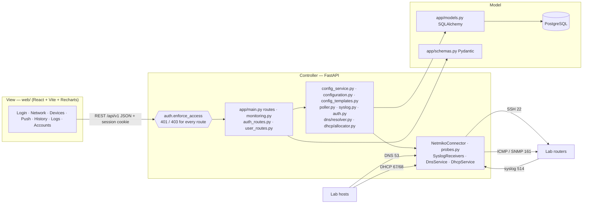

# System Structure and Critical Algorithms

## 1. Structure

The system is a modular monolith in an MVC arrangement (SRS Appendix I):



| Package / module | Responsibility | Track | Requirements |
|---|---|---|---|
| `app/models.py`, `app/schemas.py` | Tables and request/response DTOs | shared | contracts |
| `app/database.py` | Engine, session factory, SQLite FK pragma for tests | shared | — |
| `app/main.py` | App lifespan (admin bootstrap, syslog, poller), app-wide access policy, device/config/log/audit routes | A, B | R1, R3, R4, R7 |
| `app/auth.py` | Password policy and hashing, users, sessions, `current_user` and the central `enforce_access` policy | A | R7.1–R7.4, NFR-5 |
| `app/auth_routes.py`, `app/user_routes.py` | Login/logout/me; admin-only account management | A | R7.1, R7.4, R4.4 |
| `app/common_passwords.py` | Bundled common-password blocklist (NIST SP 800-63B) | A | R7.3 |
| `app/config_service.py` | Push/rollback/retrieve orchestration and per-device outcome classification | B | R3.1–R3.6 |
| `app/monitoring.py` | Read-only monitoring router, time bucketing | A | R2.2, R2.4, R2.6 |
| `app/poller.py` | Poll state machine and alert raising | A | R2.1, R2.2, R2.5 |
| `app/probes.py` | ICMP and SNMPv2c adapters, counter-to-bps conversion | A | R2.3 |
| `app/configuration.py` | Netmiko connector, credential lookup, version and audit writers | B | R3.1–R3.3, R4.4 |
| `app/config_templates.py` | Placeholder validation and rendering | B | R3.7 |
| `app/syslog.py` | UDP/TCP listeners, RFC 5424 / Cisco IOS / RFC 3164 parser, search | B | R4.1–R4.3 |
| `app/dns/` | `zones.py` rules, `resolver.py` (pure answering), `server.py` (UDP+TCP), `routes.py` | C | R5.1–R5.3 |
| `app/dhcp/` | `pools.py` rules, `packet.py` codec, `allocator.py` (state machine), `server.py` (UDP), `routes.py` | C | R6.1–R6.7 |
| `web/` | Login, Network, Devices, Push, History, Logs, Services (DNS and DHCP tabs), Accounts | all | 3.1 |

**Concurrency.** The API is async. Blocking device I/O runs off the event loop:
`poll_all` runs via `asyncio.to_thread`, and syslog uses `socketserver` threads. Each syslog
message opens its own DB session.

## 2. Critical algorithms

### 2.1 Reachability state machine (`poller.poll_device`)
For each device in id order: run the probe (an exception counts as unreachable) and append a
`PollSample`. On success, reset `consecutive_failures` to 0 and set the state to up. On failure,
increment the counter, and set the state to down at a count of 2 or more. **On an up→down edge**,
insert one `Alert` if none is open. **On a down→up edge**, stamp `resolved_at` on the open alerts.
If the probe returned interfaces, replace that device's `InterfaceStatus` rows. Each device commits
on its own, so one failure cannot roll back another's record.
Complexity: O(devices) probes per round. Statechart §1.

### 2.2 Throughput from SNMP counters (`probes.py`)
Keep the previous `(monotonic time, sysUpTime, {ifIndex: (ifHCInOctets, ifHCOutOctets)})` in a
module-level dict keyed by `(device.id, ip)`. `bps = Σ(Δoctets) × 8 / Δt` over interfaces present
in both readings. The rate is left as None, and the current reading becomes the new baseline, when
there is no previous reading, when `sysUpTime` went backwards (the device rebooted), or when **any**
counter went backwards. CPU is the mean of `hrProcessorLoad` across processors. If the SNMP call
fails, the ICMP result is kept (`combined_probe`).
*Testability note:* this math is inside `snmp_probe`, next to the network call. Extracting a pure
`compute_rates(previous, current)` would let it be unit-tested (it is currently 27% covered).

### 2.3 Metric bucketing (`monitoring.py`)
Window→bucket size: 1h→60 s, 24h→15 min, 7d→2 h. Each sample goes into
`floor(epoch / bucket) × bucket`. Each bucket gets the mean CPU, summed per-device mean throughput,
and a distinct count of devices reachable at least once. Empty buckets are omitted.

### 2.4 Configuration versioning and push (`ConfigurationService`, `save_config_version`)
De-duplicate target ids while preserving order. For each target, in three phases:
1. retrieve, save version `max(version)+1` as `pre_push`, and **commit before touching the device**;
2. apply;
3. retrieve and save `post_push`.

A failure in phase 1 or 2 is classified (`unreachable`, `rejected`, `credentials`, `failed`)
from the `DeviceError` type. A failure in phase 3 is `unverified`, because the change *is* on the
device. Each outcome is audited, with the logged-in user as actor, and the loop continues
(R3.5, statechart §3). Version numbers are monotonic per device via the `(device_id, version)` unique constraint.

### 2.5 Template rendering (`config_templates.py`)
Find placeholders with the regex `\{\{\s*([A-Za-z_]\w*)\s*\}\}`. If any `{{` or `}}` remains after
removing valid placeholders, reject the template as malformed. Require supplied keys to equal the
placeholder set exactly (reject missing or extra keys). Substitution is literal, with no expression
evaluation, so a value containing `{{` is never re-expanded.

### 2.6 Syslog parsing (`syslog.parse_syslog`)
Try RFC 5424, then the Cisco IOS default format, then RFC 3164. PRI must be ≤ 191.
`facility = PRI // 8` and `severity = PRI % 8`. For Cisco IOS, the body keeps
`%FAC-SEV-MNEMONIC: text`, and an unsynchronized router clock (`*` or `.`) means the receive time
is used. Formats without a year get the receive year, and a "Dec 31" message received on Jan 1
is dated the previous year. `source` is the message's hostname, or else the sender's IP. A message
matching no format is kept with `parsed=false` and its raw text (R4.2). Statechart §5.

### 2.7 Access decision (`auth.enforce_access`, runs before every route)
```
path not under /api/v1/  or  (POST /auth/login | /auth/logout)  → allow (public)
no valid session cookie (unknown, expired, user disabled)        → 401
non-GET request, or path under /api/v1/users, and role ≠ admin   → audit access.denied; 403
otherwise                                                         → allow
```
Because it is an app-wide dependency, the same decision applies to routes added later.
`tests/test_access_policy.py` walks every operation in the OpenAPI schema to prove it. It
uses the schema rather than `app.routes`, which in this FastAPI version omits routes from
included routers.

### 2.8 Passwords and sessions (`auth.py`)
- **Password policy** (NIST SP 800-63B): 8–64 characters, not on the bundled blocklist (checked
  regardless of case), not equal to the username. Applied on account creation, password reset, the
  env bootstrap, and by `run-lab.ps1` before startup.
- **Hashing:** argon2id with a random salt per hash. **Login timing:** an unknown or disabled
  user still costs one hash verification against a dummy hash, so response time doesn't reveal
  whether a username exists. All failures return one identical message.
- **Sessions:** a 256-bit random token in an HTTP-only, `SameSite=Lax` cookie. Only its SHA-256
  hash is stored, with an expiry (8 h). Each request looks the hash up and re-reads the user, so
  logout, expiry, disabling and role changes all take effect on the next request.
- **Last-admin guard:** `update_user` refuses (409) any change that would leave zero active
  admins.

### 2.9 DNS resolution (`dns/resolver.answer`, ADR-0006)
1. Lowercase the question name. Pick the **most specific local zone** that contains it (longest
   suffix). If none, answer **REFUSED**, without AA.
2. Set AA=1 and RA=0. Repeat at most 8 times:
   - an **SOA query at the apex** → answer with the zone's generated SOA;
   - a **CNAME at the name**, when the query isn't for CNAME → add it to the answer; follow the
     target if it is in a local zone, otherwise stop (the client resolves it);
   - **records of the queried type** → answer with them;
   - otherwise → **NOERROR/no data** if the name exists (the apex, a name with records, or an empty
     non-terminal), else **NXDOMAIN**. Either way, add the SOA (negative TTL 300 s) to the authority
     section (RFC 2308).
3. More than 8 CNAME hops → **SERVFAIL** (loop protection).

The function is pure: zone data in, reply out. `DatabaseResolver` loads the zones fresh for each
query (measured 1.41 ms median on the lab, NFR-3).

### 2.10 DHCP allocation (`dhcp/allocator.Allocator.handle`, ADR-0007)
1. **Pool selection:** by `giaddr` for a relayed request, else by `DHCP_SERVER_IP`. No pool → silence.
2. **DISCOVER:** try, in order, the MAC's reservation, its existing lease, then each address in the
   range from the lowest. Skip addresses held by an unexpired lease or reserved for another MAC.
   Claim the first that works as an `offered` lease held for 60 s. **The database's unique IP
   decides races:** if another writer committed the address first, the insert fails, is rolled
   back, and the next address is tried. Nothing free → no reply, plus one warning log per pool per
   minute (R6.7).
3. **REQUEST** (RFC 2131 §4.3.2):
   - *selecting* (server ID present): ours and the same address → bind and ACK; another server →
     drop our offer silently; otherwise NAK;
   - *init-reboot* (requested IP, no `ciaddr`): our lease → ACK; outside the subnet or someone
     else's address → NAK; no record → silence;
   - *renewing/rebinding* (`ciaddr` set): a valid bound lease → extend and ACK; otherwise NAK.
4. **Bind:** state `bound`, expiry now + the pool's lease time. **RELEASE** deletes the lease.
   The background **sweep** (every 60 s) deletes expired leases, so their addresses return (R6.6).
5. **Replies** (RFC 2131 §4.1, in `server.py`): to the relay if `giaddr` is set, unicast to
   `ciaddr` for renewals, otherwise broadcast to `255.255.255.255:68`. That is why no raw socket
   is needed. The socket is bound to `DHCP_SERVER_IP`, never `0.0.0.0`, so a multi-homed PC
   cannot answer on its real network.

## 3. Deployment

`docker-compose.yml` runs `db` (postgres:16) and `api` (uvicorn :8000, syslog :514 udp/tcp).
The web UI runs separately with the Vite dev server. To meet SRS 5.3.4, add a `web` service
(built static files served by nginx or by FastAPI `StaticFiles`) and TLS termination (NFR-7).
