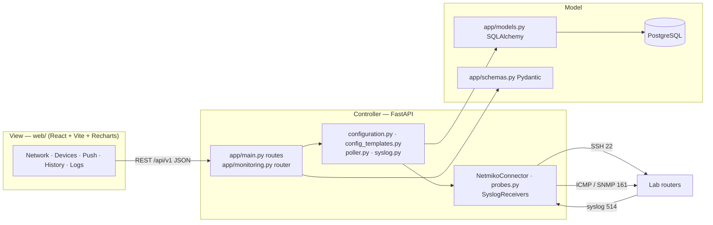

# System Structure and Critical Algorithms

## 1. Structure

The system is a modular monolith in an MVC arrangement (SRS Appendix I):

| Package / module | Responsibility | Track | Requirements |
|---|---|---|---|
| `app/models.py`, `app/schemas.py` | Tables and request/response DTOs | shared | contracts |
| `app/database.py` | Engine, session factory, SQLite FK pragma for tests | shared | — |
| `app/main.py` | App lifespan (starts syslog and poller), device/config/log/audit routes | A, B | R1, R3, R4 |
| `app/monitoring.py` | Read-only monitoring router, time bucketing | A | R2.2, R2.4, R2.6 |
| `app/poller.py` | Poll state machine and alert raising | A | R2.1, R2.2, R2.5 |
| `app/probes.py` | ICMP and SNMPv2c adapters, counter-to-bps conversion | A | R2.3 |
| `app/configuration.py` | Netmiko connector, credential lookup, version and audit writers | B | R3.1–R3.3, R4.4 |
| `app/config_templates.py` | Placeholder validation and rendering | B | R3.7 |
| `app/syslog.py` | UDP/TCP listeners, RFC 5424/3164 parser, search | B | R4.1–R4.3 |
| `web/` | Six screens planned; five present (no Login, no Services) | all | 3.1 |

**Concurrency.** The API is async. Blocking device I/O runs off the event loop:
`poll_all` runs via `asyncio.to_thread`, and syslog uses `socketserver` threads. Each syslog
message opens its own DB session.

## 2. Critical algorithms

### 2.1 Reachability state machine (`poller.poll_device`)
For each device in id order: run the probe (an exception counts as unreachable) and append a
`PollSample`. On success, reset `consecutive_failures` to 0 and set the state to up. On failure,
increment the counter, and set the state to down at a count of 2 or more. **On an up→down edge**,
insert one `Alert` if none is open. **On a down→up edge**, stamp `resolved_at` on the open alerts.
If the probe returned interfaces, replace that device's `InterfaceStatus` rows. Each device commits
on its own, so one failure cannot roll back another's record.
Complexity: O(devices) probes per round. Statechart §1.

### 2.2 Throughput from SNMP counters (`probes.py`)
Keep the previous `(monotonic time, sysUpTime, {ifIndex: (ifHCInOctets, ifHCOutOctets)})` in a
module-level dict keyed by `(device.id, ip)`. `bps = Σ(Δoctets) × 8 / Δt` over interfaces present
in both readings. The rate is left as None, and the current reading becomes the new baseline, when
there is no previous reading, when `sysUpTime` went backwards (the device rebooted), or when **any**
counter went backwards. CPU is the mean of `hrProcessorLoad` across processors. If the SNMP call
fails, the ICMP result is kept (`combined_probe`).
*Testability note:* this math is inside `snmp_probe`, next to the network call. Extracting a pure
`compute_rates(previous, current)` would let it be unit-tested (it is currently 27% covered).

### 2.3 Metric bucketing (`monitoring.py`)
Window→bucket size: 1h→60 s, 24h→15 min, 7d→2 h. Each sample goes into
`floor(epoch / bucket) × bucket`. Each bucket gets the mean CPU, summed per-device mean throughput,
and a distinct count of devices reachable at least once. Empty buckets are omitted.

### 2.4 Configuration versioning and push (`push_configuration`, `save_config_version`)
De-duplicate target ids while preserving order. For each target: retrieve, save version
`max(version)+1` as `pre_push`, commit, push, retrieve, save `post_push`, commit. Any exception
rolls back only that device's uncommitted work, writes a `failed` audit record, and continues
(R3.5). Version numbers are monotonic per device via the `(device_id, version)` unique constraint.

### 2.5 Template rendering (`config_templates.py`)
Find placeholders with the regex `\{\{\s*([A-Za-z_]\w*)\s*\}\}`. If any `{{` or `}}` remains after
removing valid placeholders, reject the template as malformed. Require supplied keys to equal the
placeholder set exactly (reject missing or extra keys). Substitution is literal, with no expression
evaluation, so a value containing `{{` is never re-expanded.

### 2.6 Syslog parsing (`syslog.parse_syslog`)
Try RFC 5424 first, then RFC 3164. PRI must be ≤ 191. `facility = PRI // 8` and
`severity = PRI % 8`. RFC 3164 lacks a year, so the receive year is used. A message that fails
both formats is kept with `parsed=false` and its raw text (R4.2). Statechart §5.

## 3. Deployment

`docker-compose.yml` runs `db` (postgres:16) and `api` (uvicorn :8000, syslog :514 udp/tcp).
The web UI runs separately with the Vite dev server. To meet SRS 5.3.4, add a `web` service
(built static files served by nginx or by FastAPI `StaticFiles`) and TLS termination (NFR-7).
