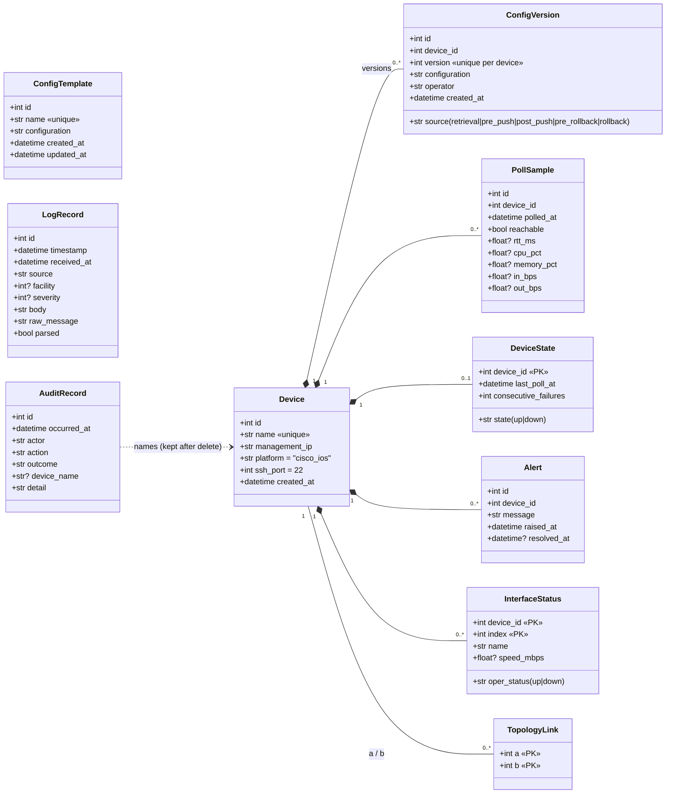
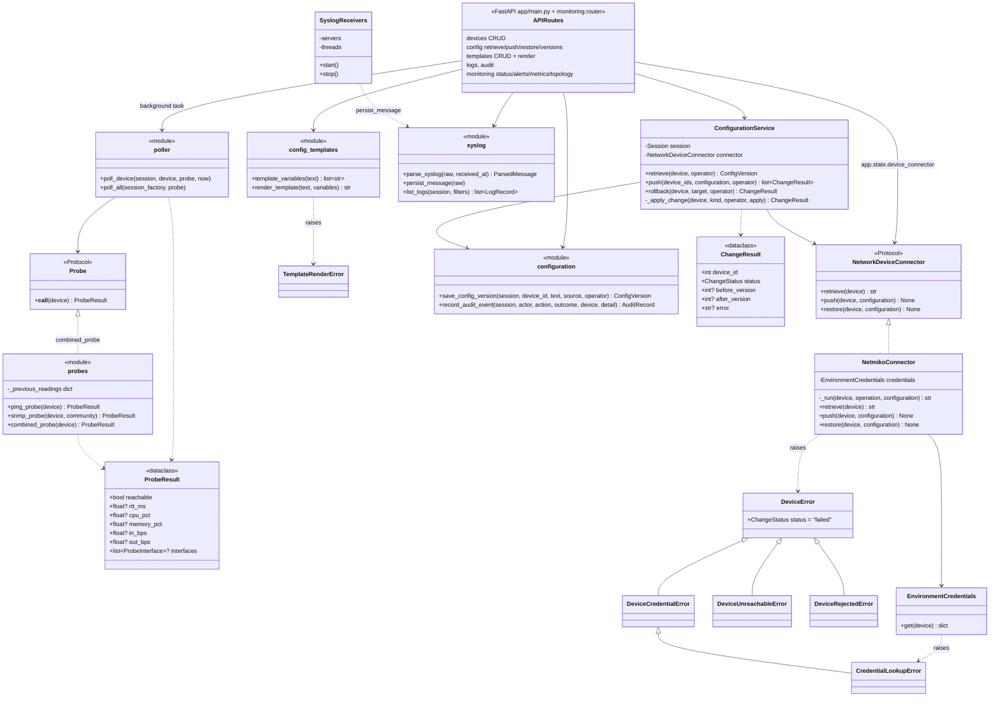

# UML Class Diagram

Generated from the code at `632ae38`. GitHub and VS Code (with a Mermaid extension) render these
diagrams; export PNGs for the slides with <https://mermaid.live>.

## Model layer (persistence — `app/models.py`)

`*--` marks composition: deleting a device cascades to these rows. `AuditRecord` stores the device
**name**, not a foreign key, so audit history survives deletion (NFR-8). `LogRecord.source` is a
hostname string and is not linked to `Device`.

## Controller / domain layer

## View layer (`web/src`)

`App` → `Layout` / `Sidebar` (from `nav.tsx`) → pages `Network`, `Logs`, `Devices`, `Push`,
`History`. Pages call `api` (`api/index.ts`), which resolves to `live.ts` (REST) or `mock.ts`
(same signatures). Shared UI primitives live in `components/ui/`.

## Design principles worth pointing out in the presentation

- **Dependency inversion.** Routes and the poller depend on `NetworkDeviceConnector` / `Probe`
  protocols, not on Netmiko or SNMP, so tests inject `FakeConnector` and fake probes.
- **Single responsibility.** Parsing (`parse_syslog`), transport (`SyslogReceivers`), and query
  (`list_logs`) are separate functions.
- **DRY / SRP (fixed in P-002).** Push and rollback share `ConfigurationService._apply_change`.
  Route handlers only validate input and map results to HTTP.
- **Exception hierarchy at the boundary.** Netmiko errors become `DeviceError` subclasses, each
  carrying a `status` and an operator-safe message, so the service never inspects library types.
- **Remaining.** `app/main.py` (385 lines) still holds device/template/log routes. Split it into routers (#19).
