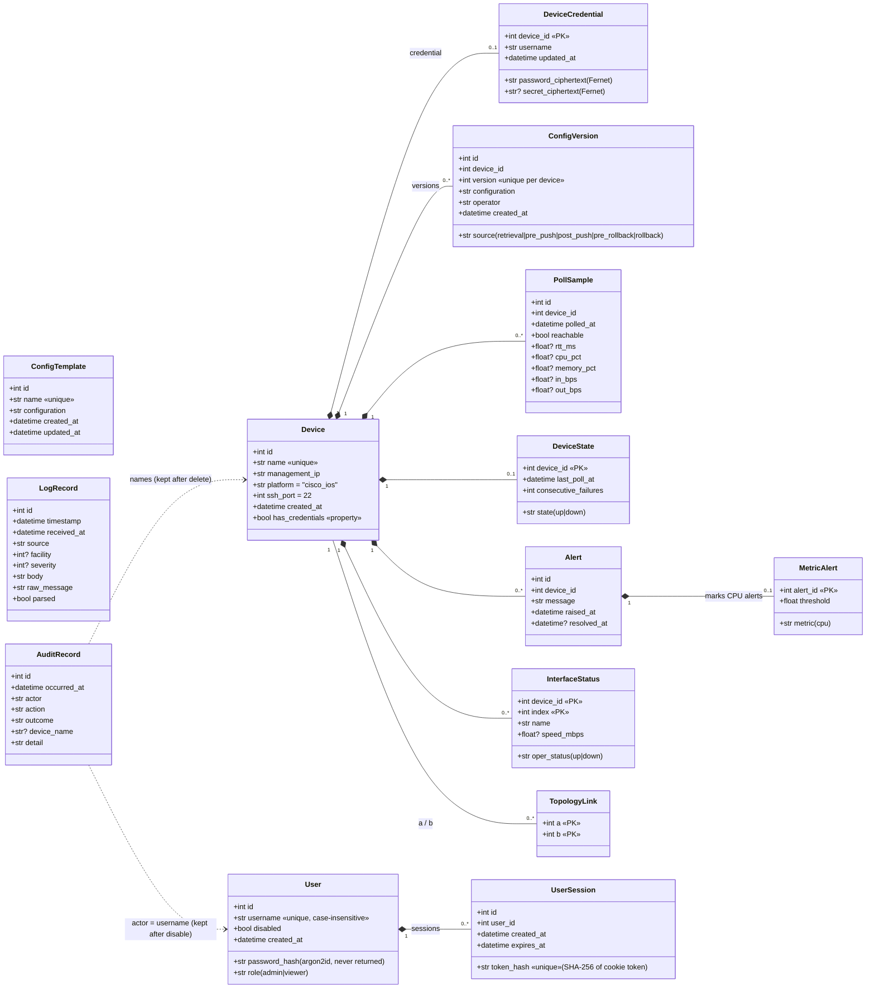
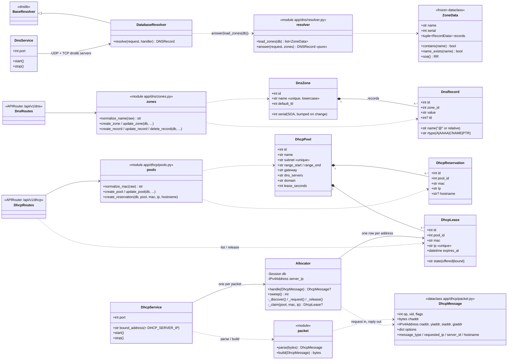

# UML Class Diagram

Generated from the code at `b0ba39e` (after P-008). GitHub and VS Code (with a Mermaid extension) render these
diagrams; export PNGs for the slides with <https://mermaid.live>.

## Model layer (persistence — `app/models.py`)

`*--` marks composition: deleting a device (or a user) cascades to these rows. Users are
disabled, never deleted, so audit history keeps a valid actor. Neither the password nor the
session token is ever stored in plaintext (R7.3, ADR-0005). Device passwords and enable secrets are stored only as Fernet ciphertext, with the key outside the database (R1.4, NFR-6, ADR-0008). An `Alert` with a `MetricAlert` row is a CPU-threshold alert; one without is a device-down alert, so the two kinds are raised and resolved independently (R2.5). Both tables were added without changing existing columns, so existing databases need no migration. `AuditRecord` stores the device
**name**, not a foreign key, so audit history survives deletion (NFR-8). `LogRecord.source` is a
hostname string and is not linked to `Device`.

## Controller / domain layer

```mermaid
classDiagram
    direction TB
    class NetworkDeviceConnector {
        <<Protocol>>
        +retrieve(device) str
        +push(device, configuration) None
        +restore(device, configuration) None
    }
    class NetmikoConnector {
        -StoredOrEnvironmentCredentials credentials
        -_run(device, operation, configuration) str
        +retrieve(device) str
        +push(device, configuration) None
        +restore(device, configuration) None
    }
    class EnvironmentCredentials {
        +get(device) dict
    }
    class StoredOrEnvironmentCredentials {
        +get(device) dict  (stored first, env JSON fallback)
    }
    class credentials {
        <<module app/credentials.py>>
        +store_credentials(db, device, username, password, secret)
        +load_credentials(device) dict?
        -_fernet() Fernet  (key from NETMGR_SECRET_KEY)
    }
    class CredentialKeyError
    class CredentialValidationError
    class ConnectionTester {
        +run(management_ip, ssh_port, platform, username, password, secret) ConnectionTestResult
        -tcp_check(host, port, timeout)
        -ssh_login(params)
    }
    class ConnectionTestResult {
        <<dataclass>>
        +bool ok
        +str? failed_stage  (reachability|login|enable)
        +str message
        +list checks
    }
    class config_diff {
        <<module>>
        +side_by_side(a, b) dict  (rows, added, removed)
        +MAX_DIFF_LINES = 5000
    }
    class DiffTooLargeError
    class Probe {
        <<Protocol>>
        +__call__(device) ProbeResult
    }
    class ProbeResult {
        <<dataclass>>
        +bool reachable
        +float? rtt_ms
        +float? cpu_pct
        +float? memory_pct
        +float? in_bps
        +float? out_bps
        +list~ProbeInterface~? interfaces
    }
    class probes {
        <<module>>
        +ping_probe(device) ProbeResult
        +snmp_probe(device, community) ProbeResult
        +combined_probe(device) ProbeResult
        -_cpu_percent(data) float?  (HOST-RESOURCES, else Cisco)
        -_memory_percent(data) float?  (Cisco memory pools)
        -_previous_readings dict
    }
    class poller {
        <<module>>
        +poll_device(session, device, probe, now, cpu_threshold)
        +poll_all(session_factory, probe)
        +cpu_alert_threshold() float
        -_check_cpu(session, device, cpu_pct, threshold, now)
    }
    class config_templates {
        <<module>>
        +template_variables(text) list~str~
        +render_template(text, variables) str
    }
    class TemplateRenderError
    class SyslogReceivers {
        -servers
        -threads
        +start()
        +stop()
    }
    class syslog {
        <<module>>
        +parse_syslog(raw, received_at) ParsedMessage
        +persist_message(raw)
        +list_logs(session, filters) list~LogRecord~
    }
    class configuration {
        <<module>>
        +save_config_version(session, device_id, text, source, operator) ConfigVersion
        +record_audit_event(session, actor, action, outcome, device, detail) AuditRecord
    }
    class ConfigurationService {
        -Session session
        -NetworkDeviceConnector connector
        +retrieve(device, operator) ConfigVersion
        +push(device_ids, configuration, operator) list~ChangeResult~
        +rollback(device, target, operator) ChangeResult
        -_apply_change(device, kind, operator, apply) ChangeResult
    }
    class ChangeResult {
        <<dataclass>>
        +int device_id
        +ChangeStatus status
        +int? before_version
        +int? after_version
        +str? error
    }
    class DeviceError {
        +ChangeStatus status = "failed"
    }
    class DeviceUnreachableError
    class DeviceRejectedError
    class DeviceCredentialError
    class auth {
        <<module app/auth.py>>
        +validate_password(password, username)
        +hash_password(password) str
        +verify_password(hash, password) bool
        +create_user(db, username, password, role) User
        +update_user(db, user, role, disabled, password) list~str~
        +bootstrap_admin(db, username, password) str
        +authenticate(db, username, password) User?
        +start_session(db, user, hours) token
        +resolve_session(db, token) User?
        +end_session(db, token)
        +current_user(request) User  «FastAPI dependency»
        +enforce_access(request)  «app-wide dependency»
    }
    class PasswordPolicyError
    class UserValidationError
    class LastAdminError
    class AuthRoutes {
        <<APIRouter /api/v1/auth>>
        POST login
        POST logout
        GET me
    }
    class UserRoutes {
        <<APIRouter /api/v1/users — admin only>>
        GET list
        POST create
        PATCH update
    }
    class APIRoutes {
        <<FastAPI app/main.py + monitoring.router>>
        devices CRUD (+ write-only credentials)
        devices/test-connection
        config retrieve/push/restore/versions/diff
        templates CRUD + render
        logs, audit
        monitoring status/alerts/metrics/topology
    }

    NetworkDeviceConnector <|.. NetmikoConnector
    DeviceError <|-- DeviceUnreachableError
    DeviceError <|-- DeviceRejectedError
    DeviceError <|-- DeviceCredentialError
    DeviceCredentialError <|-- CredentialLookupError
    NetmikoConnector ..> DeviceError : raises
    ConfigurationService --> NetworkDeviceConnector
    ConfigurationService ..> ChangeResult
    ConfigurationService --> configuration
    APIRoutes --> ConfigurationService
    NetmikoConnector --> StoredOrEnvironmentCredentials
    EnvironmentCredentials <|-- StoredOrEnvironmentCredentials
    StoredOrEnvironmentCredentials --> credentials : load_credentials
    EnvironmentCredentials ..> CredentialLookupError : raises
    credentials ..> DeviceCredentialError : wrong or missing key on load
    credentials ..> CredentialKeyError : raises
    credentials ..> CredentialValidationError : raises
    ConnectionTester ..> ConnectionTestResult
    config_diff ..> DiffTooLargeError : raises
    APIRoutes --> credentials : store_credentials
    APIRoutes --> ConnectionTester : app.state.connection_tester
    APIRoutes --> config_diff
    Probe <|.. probes : combined_probe
    probes ..> ProbeResult
    poller --> Probe
    poller ..> ProbeResult
    config_templates ..> TemplateRenderError : raises
    SyslogReceivers ..> syslog : persist_message
    APIRoutes --> NetworkDeviceConnector : app.state.device_connector
    APIRoutes --> configuration
    APIRoutes --> config_templates
    APIRoutes --> syslog
    APIRoutes --> poller : background task
    auth ..> PasswordPolicyError : raises
    auth ..> UserValidationError : raises
    auth ..> LastAdminError : raises
    AuthRoutes --> auth
    UserRoutes --> auth
    APIRoutes ..> auth : every request passes enforce_access
    UserRoutes ..> auth : identity via current_user
```

`enforce_access` is attached to the whole FastAPI app, not to individual routes. That makes it
the single point that decides 401/403 for every operation, including routers added later.

## Network services subsystems (Track C: `app/dns/`, `app/dhcp/`)

Each is a self-contained package (SRS 5.3.2) with the same layering: rules → pure logic →
socket service → REST routes. The tables live in `app/models.py` with the rest of the schema.

Exceptions: `DnsValidationError` / `DnsConflictError` and `DhcpValidationError` / `DhcpConflictError`
map to HTTP 422 / 409 in the routes. `DhcpPacketError` makes the server drop a malformed packet.
Both services are started from the app lifespan and are `None` in `app.state` when they could not
start (port taken, or DHCP's safety check failed).

## View layer (`web/src`)

`main.tsx` → `AuthProvider` (`auth.tsx`, holds the signed-in user) → `App`, which shows `Login`
when signed out, otherwise `Layout` / `Sidebar` → pages `Network`, `Logs`, `Devices`, `Push`,
`History`, `Services` (DNS and DHCP tabs: `Services.tsx`, `ServicesDhcp.tsx`), `Accounts`. `Devices` runs the connection test before adding a device and never displays credentials (only `has_credentials`). `History` renders the diff rows the server computes (R3.4); `api/mockDiff.ts` exists only so mock mode can imitate that endpoint. `useVisibleNav()` in `nav.tsx` filters admin-only items (`Push`,
`Accounts`) for viewers, and pages hide write controls with `useAuth().isAdmin`. The server still
enforces every rule; the UI just doesn't offer what would be refused. Pages call `api`
(`api/index.ts`), which resolves to `live.ts` (REST) or `mock.ts` (same signatures). Any 401
fires `netmgr:unauthorized` (`api/session.ts`), which signs the UI out. Shared UI primitives live
in `components/ui/`.

## Design principles worth pointing out in the presentation

- **Dependency inversion.** Routes and the poller depend on `NetworkDeviceConnector` / `Probe`
  protocols, not on Netmiko or SNMP, so tests inject `FakeConnector` and fake probes.
- **Single responsibility.** Parsing (`parse_syslog`), transport (`SyslogReceivers`), and query
  (`list_logs`) are separate functions.
- **DRY / SRP (fixed in P-002).** Push and rollback share `ConfigurationService._apply_change`.
  Route handlers only validate input and map results to HTTP.
- **Secure by default (single policy point).** Access control is one app-wide dependency
  (`auth.enforce_access`), not a decorator on each route, so a new route cannot be left open.
  `tests/test_access_policy.py` proves it by walking every OpenAPI operation.
- **Separation of policy and mechanism.** `auth.py` holds the rules (password policy, last-admin
  protection, session validity); `auth_routes.py` and `user_routes.py` only translate them to HTTP.
- **Exception hierarchy at the boundary.** Netmiko errors become `DeviceError` subclasses, each
  carrying a `status` and an operator-safe message, so the service never inspects library types.
- **Secrets are write-only.** Device credentials go in through the API and come out only to
  the connector. No response model has a credential field, and
  `test_r1_4_credentials_never_appear_in_any_device_response` walks every device response, the
  audit log and the errors to prove it.
- **Behaviour-preserving port with parity tests.** The diff moved from the View to the server
  (SRS 6.2) by porting the algorithm line for line and checking it against 52 outputs captured
  from the original TypeScript.
- **Remaining.** `app/main.py` (591 lines) still holds device/template/log routes. Split it into routers (#19).
