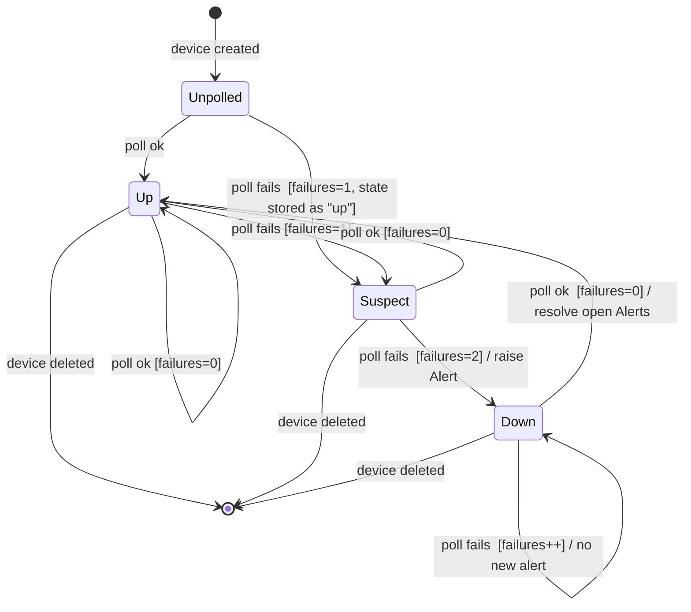
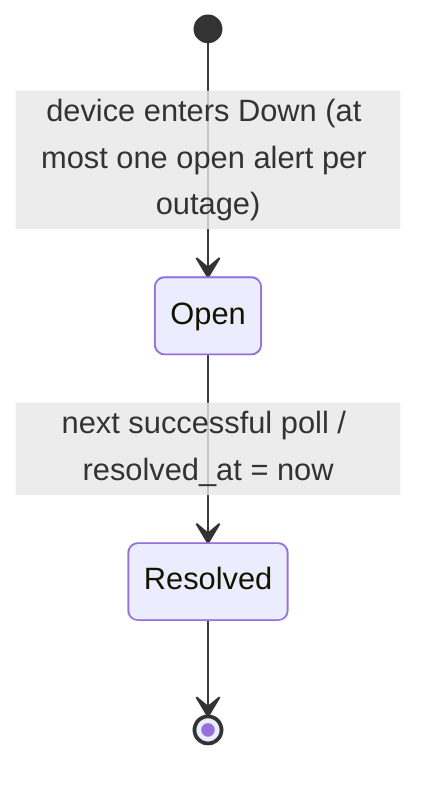
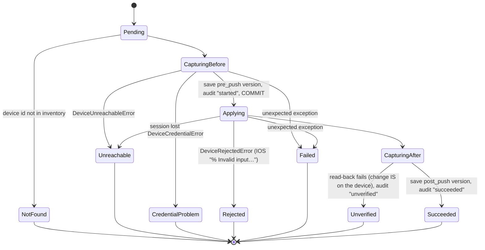
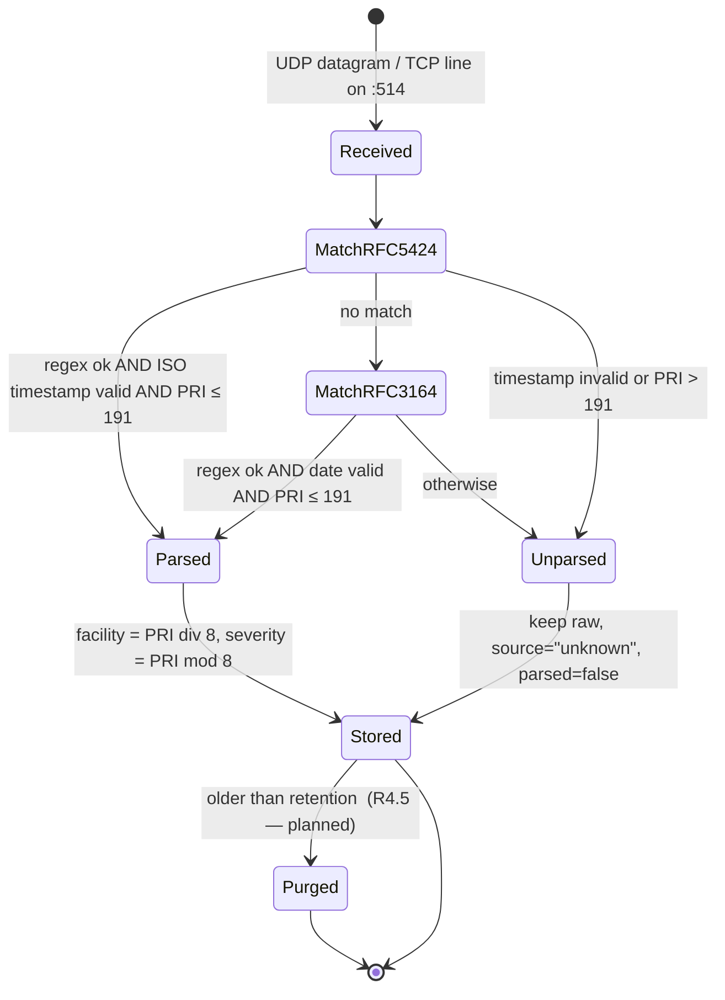
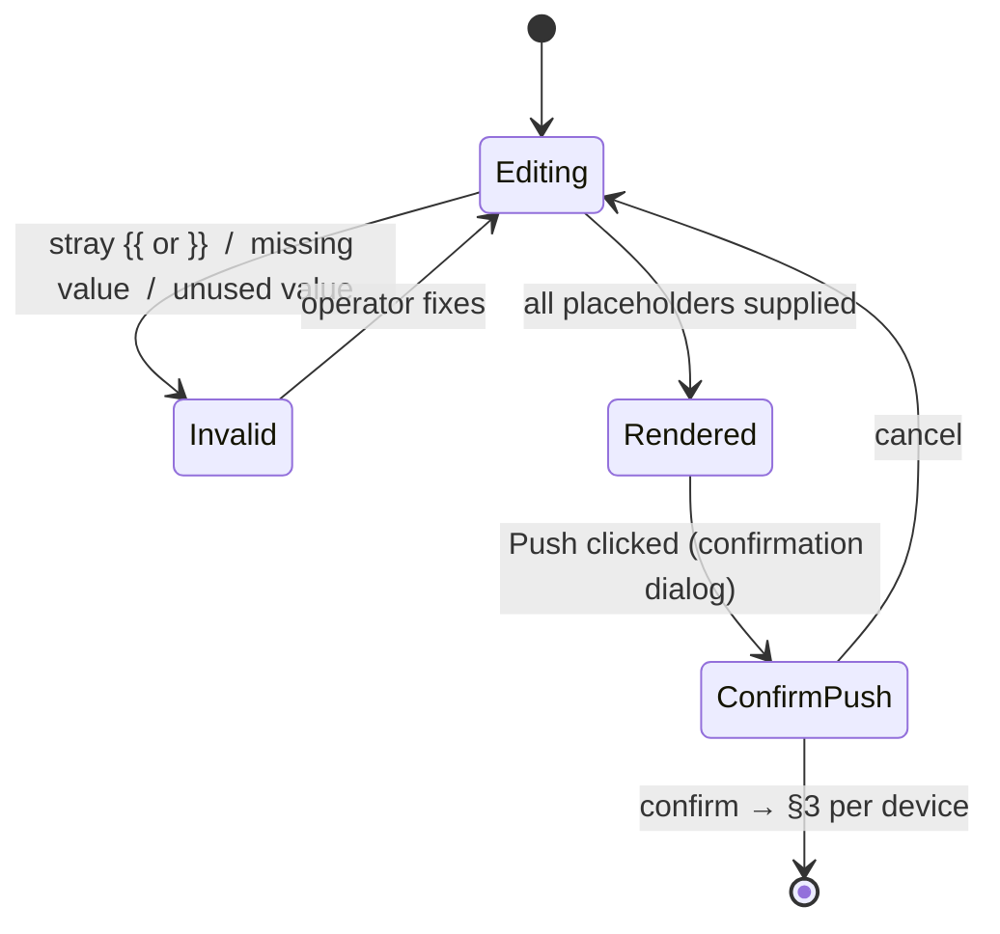
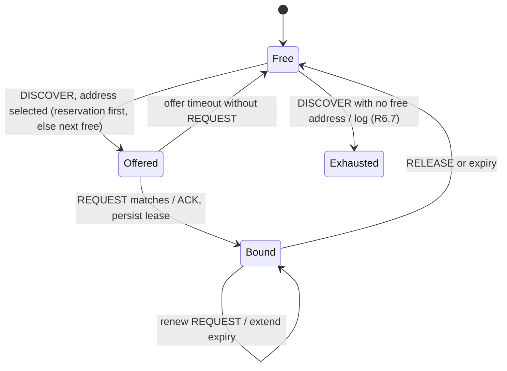
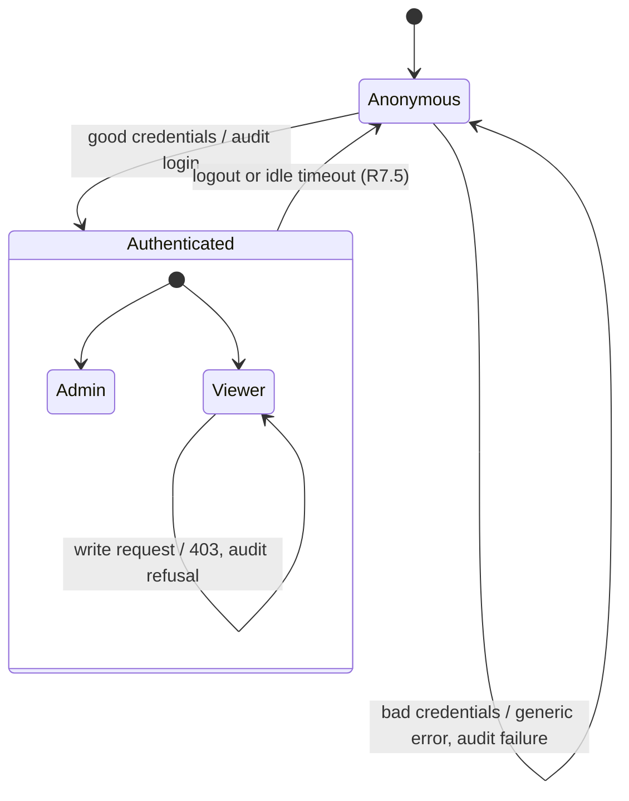

# System Statechart Diagrams

Each diagram models behavior that exists in the code (citing the function) or behavior the SRS
requires that is still **planned**. Use each transition as a test case (see `vv-plan.md` §2.3).

## 1. Device reachability — R2.2, R2.5 (`app/poller.py::poll_device`) — implemented

`Suspect` is a derived state: the DB stores `state="up"` with `consecutive_failures=1`. A probe
exception counts as a failed poll.

## 2. Alert lifecycle — R2.5 — implemented

## 3. Per-device configuration push — R3.1, R3.2, R3.5 (`app/config_service.py::ConfigurationService._apply_change`) — implemented

Each final state is the `status` value returned for that device. Every terminal state continues
with the next device (R3.5). The COMMIT before `Applying` guarantees that the pre-change snapshot
survives a failure later in the sequence. Covered by `test_r3_5_*`, `test_5_3_3_*`, and
`test_push_saves_versions_*`. (Before P-002, the read-back failure was reported as "failed".)

## 4. Rollback — R3.6 (`restore_configuration`) — implemented

Same shape as §3. The target text comes from a stored `ConfigVersion`, the saved versions are
`pre_rollback` → `rollback`, and a missing device or version returns 404 before any state is entered.

## 5. Syslog message — R4.1, R4.2 (`app/syslog.py`) — implemented

## 6. Configuration template render — R3.7 — implemented

## 7. DHCP lease — R6.1, R6.5, R6.6 — **planned (Track C)**

## 8. Operator session — R7.1, R7.2, R7.5 — **planned (Track A)**

