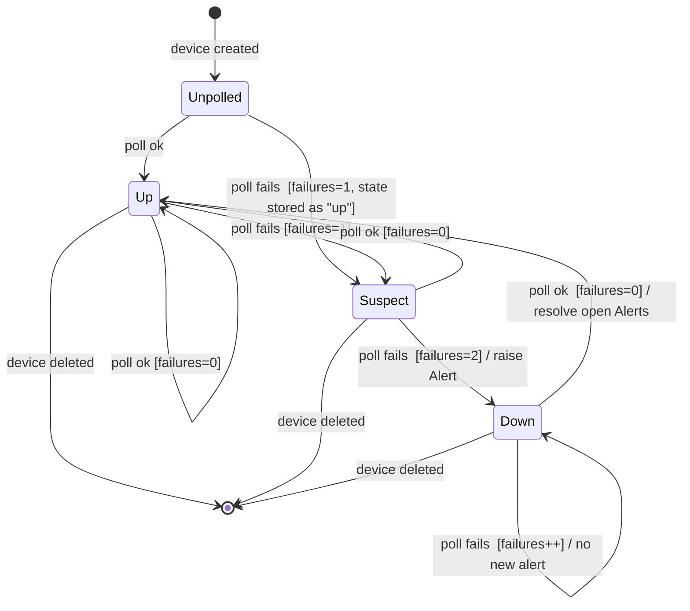
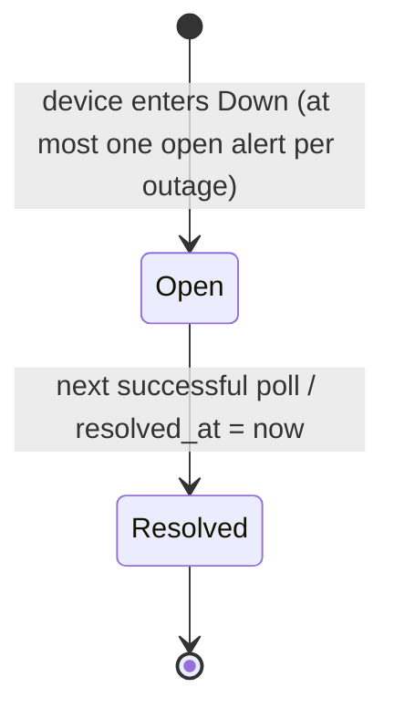
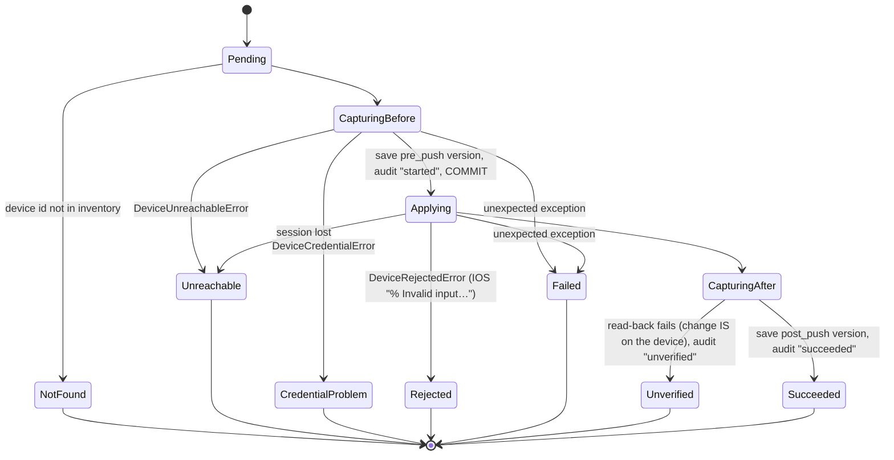
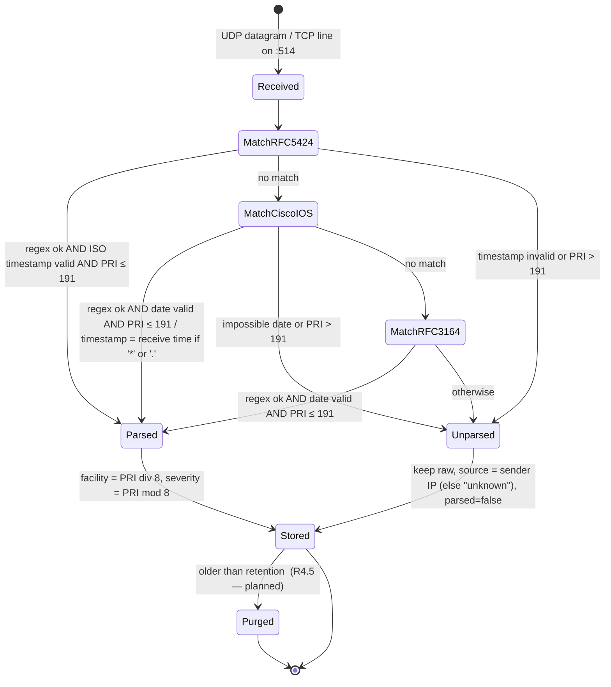
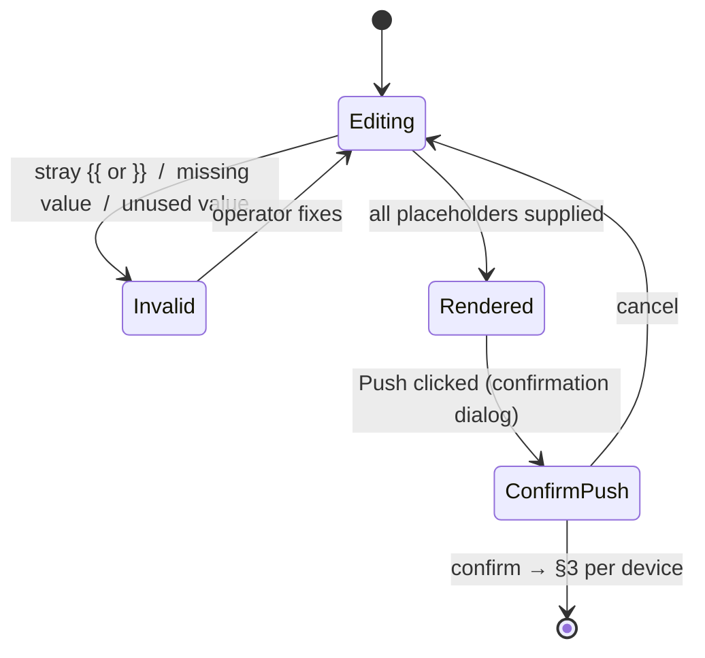
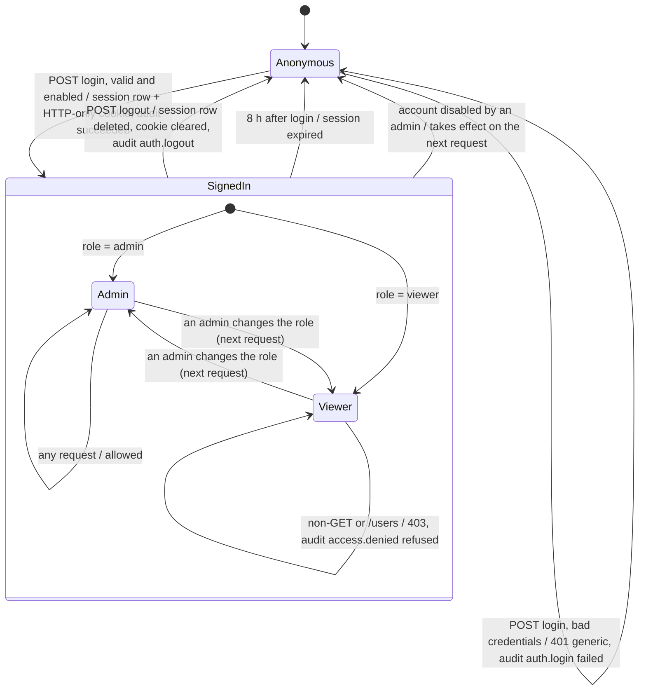
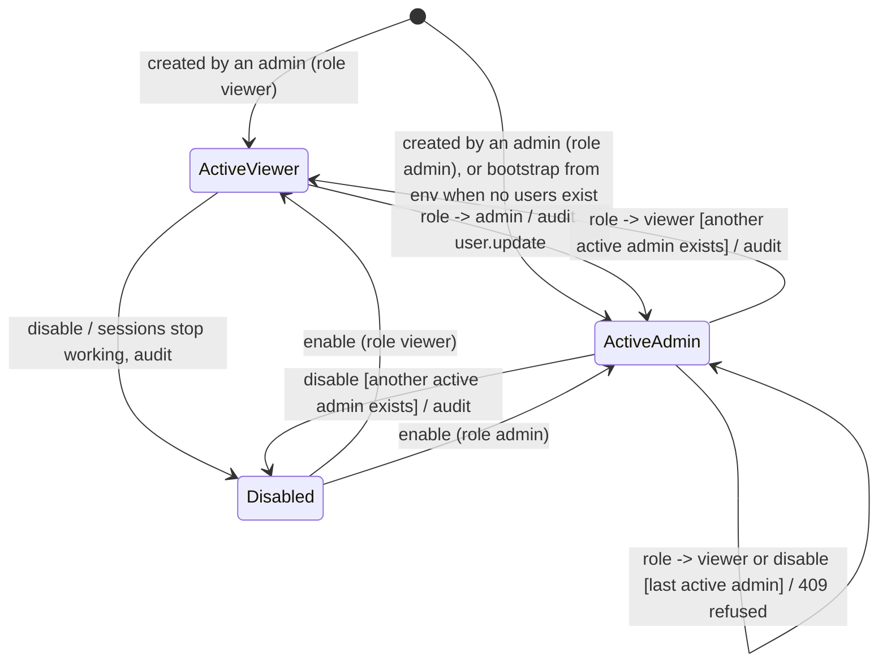

# System Statechart Diagrams

Each diagram models behavior that exists in the code (citing the function) or behavior the SRS
requires that is still **planned**. Use each transition as a test case (see `vv-plan.md` §2.3).

## 1. Device reachability — R2.2, R2.5 (`app/poller.py::poll_device`) — implemented

`Suspect` is a derived state: the DB stores `state="up"` with `consecutive_failures=1`. A probe
exception counts as a failed poll.

## 2. Alert lifecycle — R2.5 — implemented

## 3. Per-device configuration push — R3.1, R3.2, R3.5 (`app/config_service.py::ConfigurationService._apply_change`) — implemented

Each final state is the `status` value returned for that device. Every terminal state continues
with the next device (R3.5). The COMMIT before `Applying` guarantees that the pre-change snapshot
survives a failure later in the sequence. Covered by `test_r3_5_*`, `test_5_3_3_*`, and
`test_push_saves_versions_*`. (Before P-002, the read-back failure was reported as "failed".)

## 4. Rollback — R3.6 (`ConfigurationService.rollback`) — implemented

Same shape as §3. The target text comes from a stored `ConfigVersion`, the saved versions are
`pre_rollback` → `rollback`, and a missing device or version returns 404 before any state is entered.

## 5. Syslog message — R4.1, R4.2 (`app/syslog.py`) — implemented

## 6. Configuration template render — R3.7 — implemented

## 7. DHCP lease — R6.1, R6.3, R6.6, R6.7 (`app/dhcp/allocator.py`) — implemented

```mermaid
stateDiagram-v2
    [*] --> Free
    Free --> Offered : DISCOVER / pick reservation, else own lease, else lowest free; hold 60 s; OFFER
    Free --> Exhausted : DISCOVER, no free address / no reply; log (max 1 per pool per minute, R6.7)
    Exhausted --> Free : a lease is released or expires
    Offered --> Bound : REQUEST selecting our server, same address / ACK
    Offered --> Free : REQUEST selecting another server / no reply
    Offered --> Offered : REQUEST for a different address / NAK
    Offered --> Free : hold expires without REQUEST (address reusable)
    Bound --> Bound : REQUEST renewing (ciaddr = lease) / extend expiry, ACK
    Bound --> Bound : REQUEST init-reboot for its own address / ACK
    Bound --> Bound : DISCOVER again (e.g. reboot) / OFFER the same address
    Bound --> Free : RELEASE / delete lease (R6.6)
    Bound --> Free : expiry, removed by sweep (R6.6)
```

Requests are silent when the server has no pool for the subnet (no `giaddr` → the pool
containing `DHCP_SERVER_IP`; with `giaddr` → the pool containing it), so the server never
answers on a network it doesn't own. An init-reboot REQUEST for an address outside the subnet,
or one held by another client, gets NAK. One with no record of the client is ignored. Each
address can be in at most one lease (database unique constraint), so a concurrent claim fails
and the allocator moves to the next address.
Covered by `tests/test_dhcp_allocator.py`.

## 8. Operator session — R7.1, R7.2, R4.4 (`app/auth.py`, `app/auth_routes.py`) — implemented

The role is re-read from the database on every request (`resolve_session`), which is why role
changes and disabling take effect immediately. A wrong password, an unknown user and a disabled
user all produce the **same** 401 body (SRS 3.1.1). An idle timeout (R7.5, Desirable) is not
implemented; sessions end 8 hours after login (`SESSION_HOURS`).
Covered by `tests/test_auth_api.py`, `tests/test_access_policy.py`, `tests/test_auth.py`.

## 9. User account — R7.4 (`auth.create_user`, `auth.update_user`) — implemented

There is no "deleted" state: accounts are disabled, so audit records always name a real user.
A password reset (policy-checked) is a self-transition in either active state.
Covered by `tests/test_users_api.py` and `test_r7_4_bootstrap_*`.
